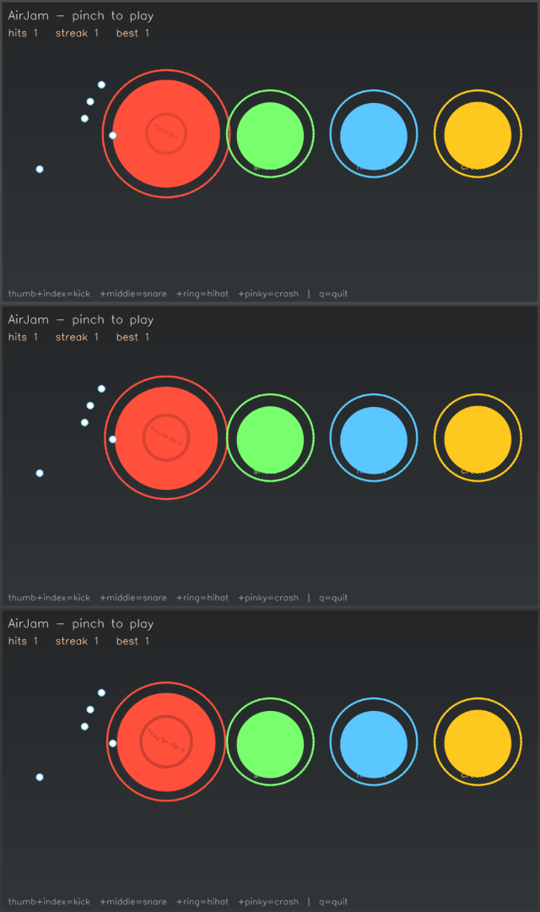

# AirJam 🥁

**Play drums in the air.** Pinch your thumb against a finger and a real drum
hits - kick, snare, hi-hat, crash - with rings, sparks and a streak counter
on screen. Pure webcam + MediaPipe, synthesized drums (no sample packs).



pinch | drum
---|---
thumb + index | kick
thumb + middle | snare
thumb + ring | hi-hat
thumb + pinky | crash

## Install

```bash
pip install git+https://github.com/Ankitavasudev/airjam@main
```

Then from anywhere:

```bash
py -m airjam
```

The hand-landmarker model ships inside the repo, so there is nothing to
download or train. Works on Python 3.9+; audio uses `sounddevice`, which
MediaPipe already brings along.

## How it works

| Layer | What happens |
|---|---|
| `tracker.py` | MediaPipe HandLandmarker (new Tasks API, VIDEO mode) gives 21 landmarks; fingertip positions and thumb-to-finger pinch distance are extracted, **normalized by hand scale** so pinch works at any camera distance |
| `app.py` | Each lane runs a **hysteresis pinch gate** (close at `d < 0.42`, release at `d > 0.55`) plus a per-lane cooldown, so one pinch is exactly one hit - no machine-gun re-triggers from jitter |
| `synth.py` | Drums are synthesized in numpy at 44.1 kHz: kick is a pitch-sweeping sine with a click transient, snare is tone + high-passed noise, hats/crash are shaped noise. Each waveform is cached on first render |
| FX | Every hit spawns an expanding ring + 14 physics-affected sparks; the frame border flashes on the hit and "ON FIRE x8" appears at streak ≥ 4 |

The audio device AirJam still runs as a fully playable silent experience, which
is also what lets the test suite (20 tests) run headless in CI.

## Interview 3-liner

> "AirJam turns a webcam into an air drum kit. I extract fingertip landmarks
> with MediaPipe's Tasks API, gate thumb-pinch gestures with hysteresis +
> per-lane cooldown so jitter can't double-trigger, and synthesize kick/snare/
> hi-hat/crash in raw numpy (pitch-sweep sine + shaped noise) instead of
> shipping sample packs. Rendering and audio are decoupled, so the whole
> game logic is headless-testable - 20 tests run in CI without any camera."
